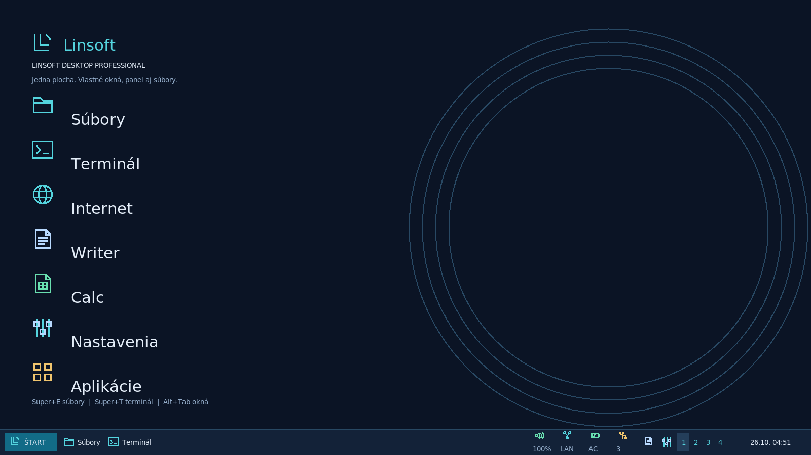

# Linsoft OS

**Váš priestor. Váš systém.** Linsoft OS is an experimental operating system built
from scratch on Linux From Scratch 12.4, with an original C/Xlib desktop
(window manager, panel, Start menu and file manager).

**Version:** Linsoft OS 1.1 (26 Oct 2026) · Linsoft Kernel 6.16.1 · LFS 12.4 · Debian 13 apps · x86-64 BIOS/UEFI/Secure Boot

**Author:** Martin Pastorek – Native desktop programmed in C (Xlib/Xft) and the
customized **Linsoft Kernel** (Linux 6.16.1: audio, network, graphics, Live
USB/DVD boot, NVMe and SD card support).

* Website: https://linsoft1.github.io/linsoft-os/
* Download: [Linsoft-OS-Live.iso](https://github.com/Linsoft1/linsoft-os/releases/latest/download/Linsoft-OS-Live.iso)
  (BIOS + UEFI, Live system and disk installer)

## Repository layout

| Path | Contents |
| --- | --- |
| [linsoft/](linsoft/README.md) | Linsoft desktop integration, Native desktop source, installers and tests |
| [linsoft/native/](linsoft/native/README.md) | Native C/Xlib/Xft desktop shell |
| [linsoft/iso/](linsoft/iso/README.md) | Live/installer ISO build, installer and QEMU test |
| [README-desktop.md](README-desktop.md) | Detailed edition history and build notes |
| `libfm`, `lxpanel`, `menu-cache`, `openbox`, `pcmanfm` | Unmodified upstream LXDE/Openbox sources (git submodules) |
| [docs/](docs/index.html) | GitHub Pages website |

Prebuilt QCOW2 disk images are not stored in this repository; the ISO is
published as a GitHub Release asset.

## Status and warnings

Experimental and tested only in QEMU virtual machines. The installer erases the
whole selected disk and does not support dual boot. Live and installed systems
log in automatically without a password. Secure Boot can stay enabled: the
first start asks once to enroll the Linsoft key in MokManager (see
[linsoft/iso](linsoft/iso/README.md#secure-boot)).

## Licenses

Linsoft OS bundles Linux, GNU, Debian and other open-source software under
their own licenses (GPL, LGPL, MIT, ...). The upstream submodules keep their
original licenses. Source for bundled third-party packages is available from
their upstream projects (Linux From Scratch 12.4 and Debian 13 archives).
